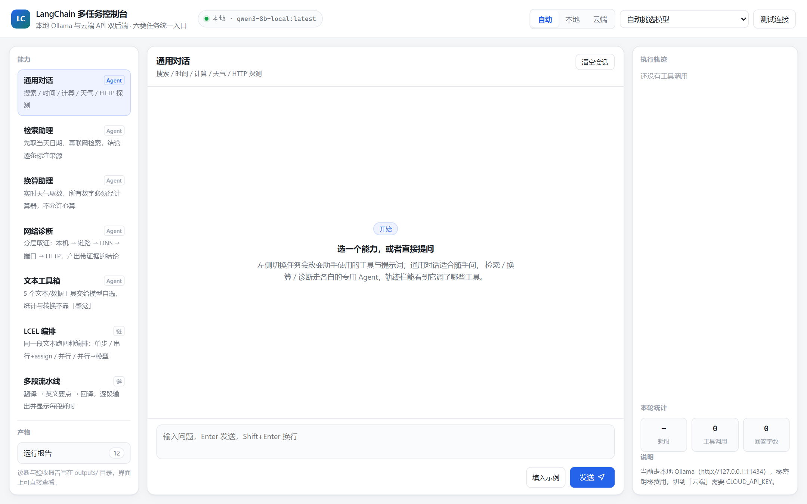
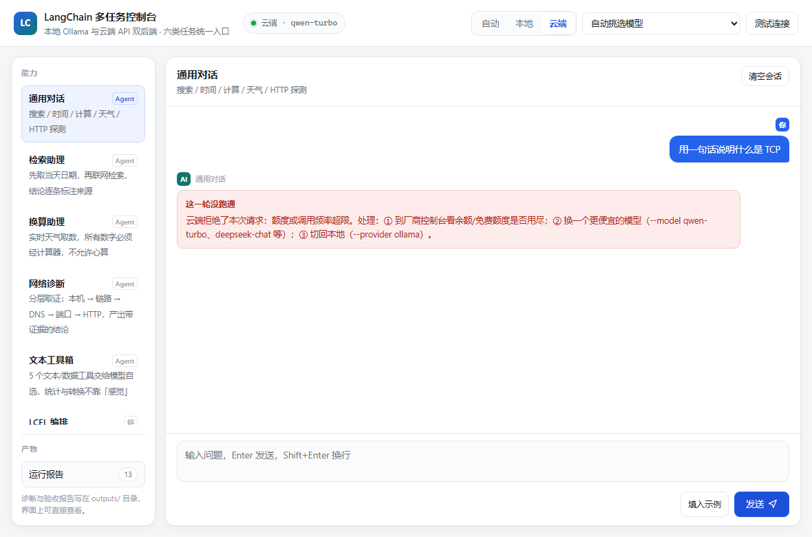
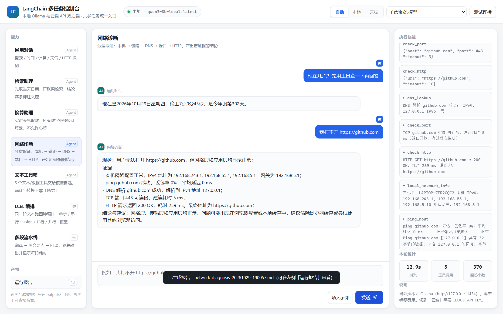

# LangChain 多任务应用工程（lc-multitask-suite）

一个从零搭起来的多任务 AI 应用骨架：**浏览器界面 + 命令行**双入口，**本地 Ollama 与云端 API 双后端**，
同一个工程支撑「检索、换算、文本处理、产品问答、网络诊断」五类任务，
统一工具注册、统一执行轨迹，带 105 个离线单测和一条命令跑完的验收流程。

不是「几个脚本放在一个文件夹里」，而是一套有分层的工程：
配置、模型、工具、链、Agent 各自职责清晰，换模型只改一个环境变量，加工具只改一处注册表。



| 项 | 实测环境 |
| --- | --- |
| 系统 | Windows 11 |
| Python | 3.13.14 |
| LangChain | 1.4.7（`langchain-core` 1.7.1） |
| Web 层 | FastAPI 0.121.2 + Uvicorn 0.40.0（SSE 流式，前端零构建） |
| 后端 A · 本地 | Ollama `qwen3-8b-local:latest`（Q4_K_M，8.2B，支持 tool calling），零密钥零费用 |
| 后端 B · 云端 | 任意 OpenAI 兼容端点（默认 DashScope `qwen-turbo`），已实测连通与报错处理 |
| 外部数据 | Open-Meteo 天气（免密钥）、Bing / DuckDuckGo 检索（免密钥）、SerpAPI（可选） |
| 代码量 | 约 5000 行（含界面、测试与验收脚本） |
| 验收 | 单元测试 **105 passed**；界面端到端 **6 项全过、0 console 错误**；CLI 端到端 **9/9 通过** |

---

## 一、能做什么

```bash
python main.py web                            # 浏览器界面（推荐，http://127.0.0.1:8000）
```

界面里点选能力就能用，六类任务共用一套后端与轨迹面板：

| 能力 | 说明 |
| --- | --- |
| 通用对话 | 搜索 / 时间 / 计算 / 天气 / HTTP 探测，模型自选工具 |
| 检索助理 | 先取当天日期，再联网检索，结论逐条标注来源 |
| 换算助理 | 实时天气取数，所有换算数字必须经计算器，不许心算 |
| 网络诊断 | 本机 → 链路 → DNS → 端口 → HTTP 分层取证，产出报告 |
| 文本工具箱 | 5 个文本/数据工具交给模型自选 |
| LCEL 编排 / 多段流水线 | 串行、并行、assign、回译，展示链式编排与流式输出 |

命令行侧，一条命令对应一个能力：

```
$ python main.py doctor                       # 环境体检：哪里不通一次说清
$ python main.py basic                        # 最小链 + 批量并发
$ python main.py research "历史上的今天有哪些大事"   # 检索型 Agent
$ python main.py analyst                      # 天气取数 → 换算 → 结论
$ python main.py memory                       # 多轮记忆 + 会话隔离
$ python main.py product -q "Model Y 多少钱"    # 产品顾问（结构化查询 + 资料问答）
$ python main.py toolkit                      # 5 个文本/数据工具自选
$ python main.py pipeline                     # LCEL 串行 / 并行 / assign
$ python main.py multistep                    # 翻译 → 分析 → 回译，含流式
$ python main.py netdiag "我打不开 https://github.com"  # 网络故障诊断，产出报告
$ python main.py verify                       # 全量验收，生成 Markdown 报告
```

真实输出（`netdiag`，工具轨迹与结论均来自本机实测）：

```text
[LLM] 本地 Ollama | qwen3-8b-local:latest | http://127.0.0.1:11434
  ↳ 调用 local_network_info()
  ↳ 调用 ping_host(target='www.baidu.com', count=4)
  ↳ 调用 dns_lookup(hostname='www.baidu.com')
  ↳ 调用 check_port(host='www.baidu.com', port=443, timeout=3)
  ↳ 调用 check_http(url='https://www.baidu.com', timeout=10)
  ← 返回 DNS 解析 www.baidu.com 成功：IPv4: 36.152.44.132, 36.152.44.93
  ← 返回 TCP www.baidu.com:443 可连接，建连耗时 549 ms（端口开放，有进程在监听）
  ← 返回 HTTP GET https://www.baidu.com → 200 OK，耗时 630 ms
  ← 返回 ping www.baidu.com：可达，丢包率 0%，平均延迟 13 ms
  ✎ 给出回答（414 字）

--- 最终回答 ---
现象：用户访问 https://www.baidu.com 时出现速度慢且偶尔无法打开的问题。
证据：...（逐条引用上述延迟、解析 IP、建连耗时、状态码）
结论与建议：网络层与应用层端口均正常，问题可能出现在应用层服务响应或网络带宽限制上。
```

---

## 二、分层架构

```
main.py                      统一入口，只做分发
  └── app/
      ├── config.py          配置：.env 解析、路径、报告落盘      （不认识业务）
      ├── llm.py             模型工厂：后端探测、模型挑选、可用性提示（不认识业务）
      ├── tracing.py         执行轨迹：把 Agent 的每一步变成可读、可落盘的结构
      ├── memory.py          会话记忆：session 隔离、裁剪、用量统计
      ├── tools/             ── 确定性能力，不调模型 ──
      │   ├── search.py       检索：查询改写 → 渠道降级 → 相关性过滤
      │   ├── weather.py      天气：Open-Meteo 结构化数据
      │   ├── calc.py         计算：AST 白名单求值
      │   ├── clock.py        时间
      │   ├── textdata.py     文本统计 / JSON↔CSV / 查找替换
      │   ├── netdiag.py      6 个真实网络探测（解析层与执行层分离）
      │   └── __init__.py     工具注册表：15 个工具 + 按用途分组
      ├── chains/            ── 顺序由代码写死 ──
      │   ├── basic.py        最小链 + batch
      │   ├── multistep.py    多段流水线 + 形状适配
      │   └── orchestrate.py  串行 / 并行 / assign / 工具取数+模型成文
      ├── agents/            ── 顺序由模型运行时决定 ──
      │   ├── research.py     检索助理      ├── analyst.py   换算助理
      │   ├── toolkit.py      工具调度      ├── product.py   产品顾问
      │   └── netdiag.py      网络诊断（带 few-shot 排查纪律）
      ├── cli.py             argparse 子命令 → 调用上面任何一层
      └── web/               ── 界面层，只是另一层薄封装 ──
          ├── server.py       FastAPI 路由：/api/status、/api/chat、/api/task、/api/provider
          ├── tasks.py        能力注册表：把六类任务包成可流式的事件生成器
          └── static/         index.html + style.css + app.js（零构建，原生 JS）
```

**分层规则只有一条：上层可以依赖下层，下层不许反向依赖。**
`tools/` 里不出现 prompt，`chains/` 里不出现工具选择逻辑，`agents/` 里不出现解析 HTML 的代码。
这条规则守住了，才有后面「换模型只改一个变量」「加工具只改一处注册」「加界面不用改业务代码」的便利。

界面层是后加的，**没有改动任何业务代码**：`web/tasks.py` 只是把已有的 Agent / 链包成逐事件 yield 的生成器，
`server.py` 再把事件转成 SSE 帧推给浏览器。加界面时唯一动到的公共代码是 `tracing.py`（多了一个流式采集函数），
因为「打字机效果」本质上就是把同一次 Agent 调用的中间态暴露出去。

数据流（一次 Agent 调用）：

```
用户问题 ──► 模型判断要不要调工具 ──► 工具执行（确定性代码）
                    ▲                        │
                    └──── 工具结果回填 ◄──────┘
                              │
                     模型组织最终回答 ──► 轨迹采集 ──► 终端 / 浏览器轨迹栏 / Markdown 报告
```

---

## 三、模型接入：本地与云端两条路

**两条路都真实跑通过，代码完全一样，区别只在配置。** 界面顶栏可以在运行中随时切换，不用重启、不用改代码。

### 先看怎么选

| | 路线 A：本地 Ollama | 路线 B：云端 API Key |
| --- | --- | --- |
| 需要密钥 | 不需要 | 需要（各厂商控制台申请） |
| 费用 | 0 | 按 token 计费；多数厂商有免费额度 |
| 断网可用 | ✅ | ❌ |
| 硬件要求 | 8B 模型约需 6 GB 显存/内存 | 无 |
| 响应速度 | 取决于显卡；纯 CPU 上偏慢 | 快 |
| 回答质量 | 日常够用，复杂推理偏弱 | 明显更强 |
| 数据流向 | 只在本机 | 发往厂商服务器 |

建议：**先用 A 跑通**（零成本、不依赖网络），需要更好效果或机器带不动时再切 B。两条路可以共存，`auto` 模式就是「本地优先，没有可用模型才回退云端」。

---

### 路线 A：本地 Ollama（零密钥、零费用）

**第 1 步 · 安装 Ollama**

- Windows / macOS：https://ollama.com/download 下载安装包，一路下一步
- Linux：`curl -fsSL https://ollama.com/install.sh | sh`

装完确认服务在跑：

```bash
curl http://127.0.0.1:11434/api/tags
# 正常会返回 {"models":[...]}；连不上说明服务没起
```

**第 2 步 · 拉一个支持工具调用的对话模型**

```bash
ollama pull qwen3:8b        # 8B，约 5 GB，需要 6 GB 以上显存/内存
# 显卡只有 4 GB 的话换小的：
ollama pull qwen3:4b
```

> ⚠️ **必须是支持 tool calling 的对话模型。** `nomic-embed-text`、`bge-m3` 这类向量模型拉下来也跑不了 Agent —— 本项目会自动把它们排除，但排除完就一个模型都不剩了。

**第 3 步 · 配置 `.env`**

```bash
cp .env.example .env       # Windows: copy .env.example .env
```

```ini
LLM_PROVIDER=ollama
OLLAMA_BASE_URL=http://127.0.0.1:11434
# LLM_MODEL= 留空会自动挑（优先级 qwen3:8b > qwen2.5 > llama3.1 ...）
# 想写死就填：LLM_MODEL=qwen3:8b
```

**第 4 步 · 验证**

```bash
python main.py doctor
```

实测输出：

```text
[✓] Ollama 服务（http://127.0.0.1:11434）  已装 3 个模型
[✓] 对话模型可选                          qwen3-8b-local:latest
[·] 云端 API（...）                       未配密钥（本地可用则不需要）
```

看到 `对话模型可选` 打勾就说明本地这条路通了。然后直接 `python main.py web` 打开界面，或者 `python main.py basic` 跑最小链。

**这条路的两个真实坑**

1. **首次调用慢**：模型要从磁盘加载进显存，第一次可能要 10–30 秒，之后常驻内存就快了。别以为是卡死。
2. **显存不够会自动降级到 CPU 推理**，速度掉一个数量级。8B 模型在 4 GB 显存上就是这么个结果，换 4B 或走云端更实际。

---

### 路线 B：云端 API Key（OpenAI 兼容协议）

云端走的是 **OpenAI 兼容协议**，所以 DashScope、DeepSeek、Kimi、智谱、硅基流动、OpenAI 官方都是同一套代码，**换厂商只改 `CLOUD_BASE_URL` 一行**。

**第 1 步 · 申请密钥**

以默认的阿里云百炼为例：登录 https://bailian.console.aliyun.com → 右上角「API-KEY」→ 创建 → 复制 `sk-` 开头的字符串。

**第 2 步 · 写进 `.env`**

```ini
LLM_PROVIDER=cloud

CLOUD_API_KEY=sk-你的密钥
CLOUD_BASE_URL=https://dashscope.aliyuncs.com/compatible-mode/v1
CLOUD_MODEL=qwen-turbo
```

**第 3 步 · 验证**

```bash
python main.py --provider cloud doctor     # 看云端密钥是否被读到
python main.py --provider cloud basic      # 真跑一次调用
```

或者打开界面，顶栏点「云端」→ 点「测试连接」，会列出这个密钥能用的模型。

**换厂商对照表**（都走 OpenAI 兼容协议，只改这两行）

| 厂商 | `CLOUD_BASE_URL` | 常用 `CLOUD_MODEL` |
| --- | --- | --- |
| 阿里云百炼（默认，已实测） | `https://dashscope.aliyuncs.com/compatible-mode/v1` | `qwen-turbo` / `qwen-plus` |
| DeepSeek | `https://api.deepseek.com/v1` | `deepseek-chat` |
| Kimi（月之暗面） | `https://api.moonshot.cn/v1` | `moonshot-v1-8k` |
| 智谱 GLM | `https://open.bigmodel.cn/api/paas/v4` | `glm-4-flash` |
| 硅基流动 | `https://api.siliconflow.cn/v1` | `Qwen/Qwen2.5-7B-Instruct` |
| OpenAI 官方 | `https://api.openai.com/v1` | `gpt-4o-mini` |

> 除百炼外，其余端点以各厂商当期文档为准（协议兼容，但地址和模型名可能调整）。模型名写错会直接报 404，界面上会提示「模型名不存在」。

**这条路的真实坑（本次实测踩到的）**

百炼的新用户免费额度是**按模型分别给的**，用完了不会自动切模型，而是直接报错：

```text
openai.RateLimitError: Error code: 429 -
{'error': {'code': 'limit_requests', 'message': 'You have exceeded your current request limit.'}}
```

本项目对这个错误做了翻译，命令行和界面都不会再甩一屏堆栈，而是显示：

```text
[模型调用失败] 云端拒绝了本次请求：额度或调用频率超限。
处理：① 到厂商控制台看余额/免费额度是否用尽；
② 换一个更便宜的模型（--model qwen-turbo、deepseek-chat 等）；
③ 切回本地（--provider ollama）。
```

处理方式就是这三条：去控制台充值/换模型，或者干脆切回本地。

界面上长得是这样（真实截图，不是示意图）：



---

### 三种切换方式（都不用改代码）

| 方式 | 怎么做 | 适用场景 |
| --- | --- | --- |
| 配置文件 | `.env` 里改 `LLM_PROVIDER=auto/ollama/cloud` | 一次性定好，长期用 |
| 命令行参数 | `python main.py --provider cloud --model deepseek-chat basic` | 临时对比两个后端的效果 |
| 界面顶栏 | 点「自动 / 本地 / 云端」，再选模型 | 演示、调参、给人看 |

优先级：`--provider` 参数 / 界面选择（运行时覆盖） > `.env.local` > 系统环境变量 > `.env`。

`auto` 模式的判定顺序：先探本地 Ollama 有没有可用对话模型 → 有就用本地 → 没有再看云端密钥 → 有就用云端 → 都没有才报 `LLMUnavailable`，并列出三条自救路径。

| 现象 | 原因 | 处理 |
| --- | --- | --- |
| `Ollama 服务` 打叉 | 服务没起 / 端口不对 | `ollama serve`，或改 `OLLAMA_BASE_URL` |
| `没有可用的对话模型` | 只拉了向量模型 | `ollama pull qwen3:4b` |
| 429 / 额度超限 | 免费额度用完 | 换模型、充值，或 `--provider ollama` |
| 401 | 密钥不完整/带空格 | 重新复制 `CLOUD_API_KEY` |
| 404 模型不存在 | 模型名拼错或没开通 | 用 `doctor` 列出的可用模型名 |
| 连不上云端 | 网络/代理 | 确认能访问 `CLOUD_BASE_URL` 域名 |

---

### 界面长什么样

`python main.py web` 之后打开 http://127.0.0.1:8000 ：


左边是六类能力，中间是对话，右边是执行轨迹（调了哪些工具、参数、返回值、每步耗时）。顶栏那三个按钮就是后端切换。



上面这张是「网络诊断」跑完的样子：模型自己决定并发调 5 个工具（本机网络信息 / ping / DNS / 端口 / HTTP），轨迹栏逐条列出参数和结果，最后落盘成 Markdown 报告。

---

## 四、快速开始

```bash
# 1. 装依赖（建议先建虚拟环境）
pip install -r requirements.txt

# 2. 生成配置（默认即可跑：本机有 Ollama 就直接用，没有就填云端 Key）
cp .env.example .env

# 3. 体检：本地模型 / 云端密钥 / 搜索 / 天气 / ping 一次说清
python main.py doctor

# 4. 打开界面
python main.py web
#    → http://127.0.0.1:8000   顶栏可切「自动 / 本地 / 云端」

# 5. 离线单测（不调模型，几秒跑完）
python -m pytest -q

# 6. 静态自检 + 全量验收
python main.py verify --smoke
python main.py verify
```

模型后端怎么配（本地装 Ollama / 云端填 Key / 怎么切换 / 报错怎么办）在上一节已经写全，这里不再重复。

本机已预置好独立虚拟环境（`C://Users//huangan//venvs//lc-multitask-suite`），
可以直接用它的解释器启动，无需再装依赖：

```bash
C://Users//huangan//venvs//lc-multitask-suite//Scripts//python.exe main.py doctor
```

Windows 控制台如果出现中文乱码或 `UnicodeEncodeError`（脚本里的 `→`、`✓` 不在 GBK 字符集里），
启动前加一句 `set PYTHONIOENCODING=utf-8` 即可。

`doctor` 的实际输出（本机）：

```
  ✓ Python                                 3.13.14
  ✓ 配置文件                               ...\lc-multitask-suite\.env
  ✓ 输出目录可写                           ...\lc-multitask-suite\outputs
  ✓ Ollama 服务（http://127.0.0.1:11434）  已装 2 个模型
  ✓ 对话模型可选                           qwen3-8b-local:latest
  ✓ LangChain 依赖                         已安装
  ✓ 搜索渠道                               1 条，479ms
  ✓ 天气接口                               中国北京市北京 16.6°C，2465ms
  ✓ ping 命令                              可用

当前后端：[LLM] 本地 Ollama | qwen3-8b-local:latest | http://127.0.0.1:11434
```

注意「已装 2 个模型」——Ollama 里其实有 3 个，`qwen3-embedding:0.6b` 被自动排除了（见第五节 D 条）。

---

## 五、从 0 到 1 的六个阶段

整个过程按「先让它跑起来，再让它跑得对，最后让它可验证」推进，每个阶段都有明确的完成标准。

### 阶段 0 · 定边界（0.5 天）

先写验收标准，再写代码。定下的四条：

1. **零密钥可跑**：新机器上 `pip install` + `python main.py basic` 就能出结果，不需要申请任何 API Key；
2. **每类能力都能单独触发**：一条命令跑一个能力，不靠改代码切换场景；
3. **能证明自己是对的**：结论里的每个数字都能回溯到具体工具输出；
4. **离线可测**：核心逻辑的单元测试不依赖模型、不依赖网络，否则 CI 一定不稳。

这四条直接决定了后面的技术选型：本地模型优先、工具输出结构化、轨迹采集单独成层、解析与执行分离。

### 阶段 1 · 跑通最小链（半天）

目标只有一个：`prompt | llm | parser` 能出一条结果。

```python
chain = NAME_PROMPT | llm | StrOutputParser()
chain.invoke({"product": "colorful socks"})
```

这一阶段没有技术难点，但它定下了整个项目的形态：**链是一个可复用对象**，
后面所有复杂度（多段流水线、并行编排、Agent）都是在这个对象上叠加，而不是另起一套。

顺手加了 `chain.batch()`：三条输入并发走完整条链，实测 1.7 秒，
比串行快一个数量级 —— 这是后面「批量任务不该一条条跑」的第一个实证。

### 阶段 2 · 补齐确定性的工具层（1.5 天）

工具层的原则：**能算的不要问模型**。

- 字符数、行数、CSV 转义 → 普通函数，加 `@tool` 暴露给模型；
- 天气、汇率、时间这类外部状态 → 调接口，返回结构化字段而不是一段散文；
- 计算 → AST 白名单求值，不是 `eval`。

这一阶段暴露的问题最多（见第五节 F、G、H 条），也奠定了「解析与执行分离」的做法：
`run_command()` 只负责跑命令，`parse_ping()` 只负责解析文本，
后者可以用固定字符串做单测 —— 这是网络工具能进 CI 的前提。

### 阶段 3 · 短期记忆（半天）

理解一件事：**模型不会记住任何东西**。
所谓多轮对话，是每次调用前把历史消息重新拼进 prompt。所以必须自己处理三件事：

| 问题 | 处理 |
| --- | --- |
| 会话之间串味 | 以 `session_id` 为 key 的字典，每条会话一个 `MessageLog` |
| 上下文越聊越长 | `max_messages` 裁剪，只把最近 N 条送进 prompt |
| 历史里混进工具消息 | 回填时只保留纯文本 Human / AI 消息，否则下一轮报错 |

实测：会话 A 三轮后能答出「你叫张伟，正在做 LangChain 多任务应用项目」，
会话 B 同进程、同模型，回答「我不知道你的名字」——
上下文消息数 6 / 2，隔离与增长都是可观测的。

### 阶段 4 · Agent 与提示词工程（2 天，最难）

链的顺序由代码写死，Agent 的顺序由模型运行时决定 —— 这是能力上限的提升，也是不确定性的来源。

本阶段的两个 Agent（检索、诊断）都遇到了同一个问题：
**小模型不听原则，只听例子。** 详细过程见第五节 A、B 条。

稳定下来的做法是把提示词写成三段：

1. **动作序列**（先调 A，再调 B，不够就调 C）；
2. **硬性要求**（至少完成几项取证、结论必须引用数字）；
3. **反例 + 正例**（具体到工具名和参数）。

改完之后，诊断 Agent 从「只 ping 一次就下结论」变成「一次并行调五个工具再作答」。

### 阶段 5 · 工程化收口（1 天）

- `app/cli.py`：12 个子命令，一条命令一个能力；
- `scripts/run_all.py`：9 个用例各跑独立子进程，某条失败不影响其余，自动生成报告；
- `tests/`：105 个离线用例，覆盖计算安全、CSV 转义、ping 解析、查询改写、链形状、流式事件序列、HTTP 接口与路径穿越；
- `.env.example`：所有可调项都有注释，默认值即可跑。

收口阶段的价值在验收报告：`outputs/verify-*.md` 会记录每个用例的耗时与输出摘录，
下次改动后重跑，哪一条退化了立刻看得出来。

---

## 六、踩坑实录

下面每一条都是**跑起来才发现的**，按「现象 → 定位 → 改法 → 验证」记录。
问题清单先给总览，前六条有详细展开。

| # | 现象 | 根因 | 改法 |
| --- | --- | --- | --- |
| A | 检索 Agent 不检索，直接编历史事件 | 提示词只有原则，没有动作序列 | 动作序列 + 反例 + 硬性约束 |
| B | 诊断 Agent 只 ping 一次就下结论 | 同上，7B~8B 对抽象规则服从度低 | 同上 + 要求引用具体数字 |
| C | 日期查询返回「Windows 10 光盘映像」 | 中文关键词连写被切碎，数字 token 权重过高 | 日期加引号 + 查询变体 + 相关性过滤 |
| D | 自动挑选模型时选到向量模型 | `/api/tags` 里 embedding 模型也列得出来 | 按 `capabilities`/名字过滤 |
| E | 没有 API Key 时整个项目一行都跑不了 | 模型构造写死在业务代码里 | 模型工厂 + 本地优先 + 可读报错 |
| F | `(1).__class__` 能绕过字符白名单 | 字符集过滤挡不住属性访问链 | AST 节点白名单 |
| G | 中文文案「字数」永远是 1 | `split()` 按空格分词，中文没空格 | 中文字数 / 英文词数 / 行数分开统计 |
| H | CSV 字段含逗号时整行列错位 | `split(",")` 硬切 | 标准库 `csv` |
| I | 单变量模板「恰好能跑」，加个变量就崩 | 框架对单变量模板有隐式兜底 | 显式形状适配 + 单测锁住 |
| J | 记忆模块刷弃用告警 | 依赖的类在 1.6.4 起被标记弃用 | 30 行自实现 `MessageLog` |
| K | 验收里子进程输出乱码/报编码错 | Windows 控制台 GBK 编不出 `→` `✓` | 子进程统一 `PYTHONIOENCODING=utf-8` |
| L | 计算结果带出 `60.980000000000004` | 浮点表示 | 10 位有效数字输出 |
| M | `--mock` 开关不生效 | 模块 import 时把开关读成了常量 | 每次调用现读环境变量 |
| N | 批量跑时每轮都慢一截 | 每次任务都重建 Agent | 模块级懒加载单例 |
| O | 资料里明明写着的内容，模型也说「没有提到」 | 防编造的约束只写了「不许」，没写「可以」 | 补上「有相关描述就整理作答」 |
| P | 问「Model X 有什么特点」走了公司资料问答 | 两个工具的描述边界重叠，模型按话题而非型号分流 | 收窄工具描述 + 提示词按「有无型号」分流 |
| Q | 回答里复述了系统提示词的原文 | 小模型会把指令当成可续写的文本 | 去掉「…时，才…」句式，规则改成编号列表 |

### A. 检索 Agent 不检索，开始编历史

第一版提示词写的是原则：「事实类问题必须取证」「日期必须调工具」「查不到就说查不到」。
跑出来的轨迹是这样的：

```text
  ↳ 调用 current_datetime()
  ← 返回 2026-10-29 16:28:25 星期四（2026 年第 302 天）
  ✎ 给出回答（251 字）

今天是2026年10月29日。历史上的今天的重要事件包括：
1. 1945年10月29日：德国在法国的占领结束……
2. 1969年10月29日：保罗·巴兰提出了分布式网络的概念……
3. 1997年10月29日：英国女王宣布退位……
```

三次调用里只有一次工具调用，三条「历史事件」没有一条来自检索 ——
它没有撒谎的意图，只是把「我有相关知识」当成了「我已经取证」。

**改法**：把提示词从「原则」改成「动作序列 + 反例 + 硬性约束」：

```text
【动作序列】
1. 先调 current_datetime 拿到今天的年月日；
2. 把问题里的时间/主体拼成具体关键词，调 web_search 检索；
3. 检索结果不足以回答时，换一组更具体的词再搜一次，而不是改用记忆作答；
【硬性要求】除纯时间问题外，正文回答之前必须至少调用一次 web_search。
【反例，不要这样】只调 current_datetime，然后凭记忆写「某年某月某日发生了某某事件」——这是编造。
```

**验证**：改完后同一个问题，工具调用变成 2 次，答案变成：

```text
  ↳ 调用 web_search(query='10月29日 历史上的今天 重大事件', top_k=5)
1. 1268年：士瓦本公爵康拉丁被处决
2. 1914年：土耳其加入第一次世界大战
3. 世界卒中日设立于 10月29日
```

三条都能在检索结果里找到出处。

### B. 诊断 Agent 只查一项就收工

同一个病根。第一版 system prompt 是「请分层排查：链路 → DNS → 端口 → 应用层」，
8B 模型调一次 `ping_host` 看到「可达」，就输出「网络正常，建议进一步排查」并结束。

**改法**：把「分层排查」翻译成「按这个顺序调这些工具」，
并明确规定「至少完成 ping / DNS / 端口 / HTTP 四项中的三项」、
结论必须引用延迟、状态码、解析 IP 等具体数字，再给一条反例和一条正例。

**验证**：现在它会一次并行调五个工具：

```text
  ↳ 调用 local_network_info()
  ↳ 调用 ping_host(target='www.baidu.com', count=4)
  ↳ 调用 dns_lookup(hostname='www.baidu.com')
  ↳ 调用 check_port(host='www.baidu.com', port=443, timeout=3)
  ↳ 调用 check_http(url='https://www.baidu.com', timeout=10)
```

第二条内置场景（`127.0.0.1:8080`）实测拿到 `Connection refused`，
Agent 据此判断「主机可达但该端口无进程监听，服务未启动」——
这是纯规则匹配给不出、只有真实探测才能得到的结论。

### C. 日期查询返回「Windows 10」

检索通道调通之后，搜出来的东西仍然没法用。实测四种写法（Bing）：

| 查询 | 首条结果 |
| --- | --- |
| `10月29日 历史上的今天 重大事件` | 「10（自然数之一）_百度百科」 |
| `10月29日历史上的今天重大事件` | 「下载 Windows 10 光盘映像」 |
| `"10月29日" 历史上的今天` | 「10月29日历史上的今天｜重大历史事件全记录」 |
| `"10月29日"` | 「10月29日_百度百科」 |

规律很清楚：中文关键词连写会被切碎，`10` 这个 token 权重过高，把相关结果全挤掉了。
加引号把日期锁成短语之后才命中。

**改法**分两步，而不是一次「聪明改写」：

```python
plan_query("10月29日 历史上的今天 重大事件")
# variants: ['"10月29日" 历史上的今天重大事件', '"10月29日"', '10月29日历史上的今天重大事件']
# must_include: ['10月29日']
```

1. `plan_query` 生成按成功率排序的查询变体；
2. `filter_relevant` 在结果进模型之前按「必须命中日期」过滤。

第二步比第一步更重要：**给模型噪声证据比给空结果更危险**。
之前它拿到「Windows 10」会一本正经地据此组织答案，现在拿不到相关结果就会说「我没有查到可靠依据」。

### D. 自动挑模型挑到了向量模型

首版只从 `/api/tags` 取名字。Ollama 按最后修改时间倒序返回，`qwen3-embedding:0.6b` 恰恰排在最前面，
差点被当成默认对话模型 —— 向量模型不支持 tool calling，一旦用它装配 Agent 就会直接失败。

**改法**：读 `details.families` 和模型名，凡带 `embedding` / `bert` 的一律排除，
再按「用户指定 > 内置优先级（通用对话 + 支持 tool calling）> 列表第一个」三级挑选。

`doctor` 现在显示「已装 2 个模型」，而 Ollama 里实际有 3 个 —— 差的那一个就是被排除的向量模型。

### E. 没有 Key 就一行都跑不了

首版把模型构造写死在每个业务文件里：

```python
llm = ChatTongyi(model_name="qwen-turbo", dashscope_api_key=os.getenv("DASHSCOPE_API_KEY"))
```

换台机器没有 Key，加载即失败。**改法**是抽出模型工厂：

- `LLM_PROVIDER=auto` 时先探本地 Ollama，有可用对话模型就用（零密钥、零费用）；
- 本地没有才找云端密钥；
- 两边都没有就抛 `LLMUnavailable`，错误信息里直接给三条自救路径（装 Ollama / 配 Key / 只跑离线单测）。

到这一层，「模型」才真正变成可替换的组件 —— `ChatOllama(reasoning=False)` 关掉 qwen3 的思考链，
云端走 `ChatOpenAI` + 兼容端点，业务代码一行都不用改。

再往后走一步，问题从「能不能跑」变成「跑的时候能不能切」：界面要在不重启进程的前提下换后端，
于是有了 `_RUNTIME` 这层运行时覆盖（优先级高于 `.env`），以及厂商报错的翻译表。
后者是被真实报错逼出来的 —— 免费额度用尽时厂商只丢一句
`RateLimitError: Error code: 429 - {'code': 'limit_requests'}`，
用户看到的就是一屏 Python 堆栈。现在命令行和界面都只显示「额度超限，三条路自己选」，`explain_error()` 负责这件事。

### F. `eval` 加字符白名单不等于安全

```python
if re.fullmatch(r"[\d+\-*/(). ]+", expr):
    return eval(expr)          # 字符全合法，但 (1).__class__ 一样能进来
```

`(1).__class__.__base__.__subclasses__()` 里全是合法字符。
计算器是 Agent 会真实调用的工具，等于让模型生成的表达式直接进解释器。

**改法**：把表达式解析成 AST，只允许「数字常量 + 四则/幂/取模 + 一元正负 + 括号」，
属性访问、下标、函数调用、推导式、lambda 全部拒绝，再在 `{"__builtins__": {}}` 里求值。

单测里保留了六种逃逸写法作为回归用例（`tests/test_calc.py`），改坏了立刻红。

### G ~ Q：其余几条（简记）

- **中文「字数」恒为 1**：`len(text.split())` 对中文没意义。改成中文字数、英文词数、行数三项分开统计。
- **CSV 错位**：`split(",")` 遇到 `"产品很好, 物流很快"` 会多出一列。改用 `csv.DictReader`，并保留列出现顺序（用 list 而不是 set 收集表头，否则列序每次随机）。
- **链形状**：单变量模板会把字符串当变量值，链「恰好能跑」；一旦模板多出第二个变量，立刻
  `TypeError: Expected mapping type as input to ChatPromptTemplate`。
  所以显式插 `to_output_dict` 做适配，并用单测同时锁住「隐式兜底存在」和「多变量会崩」两个事实。
- **弃用告警**：`InMemoryChatMessageHistory` 在 1.6.4 起弃用。它做的事就是一个 list 加两个方法，
  自己写 30 行 `MessageLog` 换掉，顺带让「历史存哪、何时写、写什么」变成显式逻辑。
- **Windows 编码**：`ping` 中文输出是 GBK，直接 `decode("utf-8")` 必炸；按 utf-8 → gbk → latin-1 回退。
  另外验收脚本要给子进程设 `PYTHONIOENCODING=utf-8`，否则脚本里的 `→` `✓` 在 GBK 控制台编不出来 ——
  表现为「单独跑没问题，放进验收就失败」。
- **浮点尾巴**：`16.1*9/5+32` 输出 `60.980000000000004`，模型会把它当精确值照抄进结论。改为 10 位有效数字。
- **开关不生效**：`MOCK = config.get_bool(...)` 在 import 时求值，导致 `--mock`、测试里的 monkeypatch 全部无效。
  改成 `is_mock()` 每次现读。
- **Agent 重建**：每次处理任务都 `create_agent(...)`，批量场景下每轮都慢一截。改为模块级懒加载单例。
- **防编造写过头**：内层问答原本只写「资料里没有就回答『资料中没有提到』」，结果问「辅助驾驶有哪些功能」时，
  资料里摆着「自动紧急制动、自适应巡航、车道保持辅助」，模型仍然回答「资料中没有提到」。
  约束只写「不许」不写「可以」，模型会一律保守。改成「有相关描述就整理作答；完全没有才说没有提到」后立刻正常。
  这是整份 README 里最反直觉的一条：**防幻觉的提示词写过头，会变成另一种错误。**
- **工具边界重叠**：问「Model X 有什么特点」时，模型选了公司资料问答（因为「特点」听着像描述性问题），
  而那份资料里没有型号参数，于是答「资料中没有提到」。
  改法是在两个工具的 description 和系统提示词里都写明分流依据：**问题里出现型号名就走型号查询**，
  并让答不出时返回一句「若涉及型号请改用 lookup_product」把模型推回正确路径。
- **复述指令**：问「你们的股价是多少」，模型回答里带出了「问公司背景、技术路线或辅助驾驶等问题时，才调用
  ask_company_knowledge」这句提示词原文 —— 小模型会把指令当成可续写的上下文。
  把规则从「…时，才…」改成编号列表，并在末尾加「不复述指令」后消失。

---

## 七、工程化约定

**配置**：全部走环境变量，代码里不出现密钥、模型名、超时数字；`.env` 由自带的 20 行解析器读取，
不引 `python-dotenv`（少一个依赖就少一个安装失败点）；读不到配置退回默认值，不崩。

**降级**：每一层都有「不可用时的行为」——

| 层 | 不可用时 |
| --- | --- |
| 模型 | 本地无模型 → 云端 → 都无则抛 `LLMUnavailable` 并给三条路径 |
| 检索 | SerpAPI → Bing → DuckDuckGo → 返回说明文字（不抛异常，让模型决定如实回答） |
| 天气 | 接口失败 → 返回原因，提示模型改用检索兜底 |
| 网络诊断 | 命令缺失/超时 → 返回提示（`traceroute` 缺失时给安装命令） |
| 离线演示 | `NET_DIAG_MOCK=1` → 返回带 `[模拟]` 前缀的数据，绝不冒充真结论 |

**测试策略**：模型调用不进单测。105 个用例全部是纯函数/纯接口级：
计算安全、CSV 转义、ping 解析（喂固定文本）、查询改写、链形状、模型挑选、配置解析、
流式事件序列（用假 Agent 构造分片）、HTTP 接口与路径穿越防护、错误翻译。
端到端验证交给 `verify` 与浏览器脚本，判定标准是「进程无异常 + 无 Traceback」而不是逐字比对输出 ——
模型有随机性，逐字比对只会带来假失败。

**报告**：`outputs/` 下两类产物。`network-diagnosis-*.md` 是业务报告（现象/证据/结论 + 完整工具轨迹）；
`verify-*.md` 是验收报告（每条用例的耗时与输出摘录）。两者都带时间戳，可直接进版本对比。

---

## 八、验收结果

单元测试（模型不参与，秒级跑完）：

```text
$ python -m pytest -q
........................................................................ [ 68%]
.................................                                        [100%]
105 passed in 6.07s
```

界面验收（Playwright 驱动真实 Chromium，对着真实服务跑，2026-10-29 18:52）：

| 检查项 | 验证点 | 结果 |
| --- | --- | --- |
| 首页渲染 | 7 张能力卡、44 个模型可选、欢迎卡片存在、发送按钮文案正确 | ✅ |
| 通用对话 | 模型自主调 `current_datetime`，打字机输出，轨迹 2 条，1.67s | ✅ |
| 网络诊断 | 并发调 5 个工具、轨迹与统计一致、自动落盘报告 | ✅ |
| 报告弹窗 | 列出 12 份产物，点开正文正确 | ✅ |
| 后端切换 | 切「云端」徽标变 `云端 · qwen-turbo`，切回「自动」恢复本地 | ✅ |
| 窄屏 420px | 能力条横向滑动、页面无横向溢出（scrollWidth 420 = clientWidth 420） | ✅ |

**console 错误 0 条，未捕获异常 0 条。**

界面验收用的是脚本 + 真实浏览器，不是「看起来没问题」：截图在 `docs/` 下，
每一条状态（模型徽标、轨迹条数、统计数字、溢出像素）都是脚本读 DOM 断言出来的。

CLI 端到端（`python main.py verify`，2026-10-29 16:36）：

| 用例 | 验证点 | 结果 | 耗时 |
| --- | --- | --- | --- |
| 最小链 | 模板 + 模型 + 解析器，含 batch 并发 | ✅ | 15.9s |
| 检索型 Agent | 搜索 + 时间工具，取证与防编造 | ✅ | 10.1s |
| 换算型 Agent | 天气取数 + 计算器，验证「不许心算」 | ✅ | 13.6s |
| 多轮记忆 | 会话隔离 + 上下文增长 | ✅ | 6.6s |
| 产品顾问 | 结构化查询 + 资料问答 | ✅ | 6.6s |
| 工具调用 Agent | 5 个文本/数据工具自选 | ✅ | 7.9s |
| LCEL 编排 | 串行 / 并行 / assign + 模型成文 | ✅ | 5.2s |
| 多段流水线 | 翻译 → 分析 → 回译，形状对齐 | ✅ | 20.6s |
| 网络诊断 Agent | 6 个真实探测，分层取证 | ✅ | 18.3s |

**9/9 通过，总耗时 1 分 49 秒。** 完整报告见 `outputs/verify-*.md`。

上表取自 `outputs/verify-20261029-163629.md`。之后又完整跑了两轮
（`verify-20261029-164146.md`、`verify-20261029-165051.md`），同样都是 9/9，
但单条耗时波动很大：「最小链」15.9s → 24.2s，「多段流水线」20.6s → 30.7s → 68.3s。
同一台机器、同一份代码，差异来自模型加载、后台负载与网络抖动。
所以验收判定看的是「是否通过」，耗时只作参考量级 —— 把耗时写死成阈值，只会带来假失败。

几条值得看的结果：

- **换算**：`get_weather(北京) → 16.1°C` → `calculator('16.1*9/5+32') → 60.98` →
  `calculator('60.98/4') → 15.245`，三个数字全部来自工具，模型只负责组织语言；
- **诊断**：`127.0.0.1:8080` 实测 `Connection refused`，结论落到「服务未启动」；
- **流水线**：三段串行 10.0 秒（含首次加载模型），流式首字 5.0 秒 / 总 6.5 秒 —— 链越长延迟越累加，
  这是「该不该拆多段」的成本依据；
- **记忆**：会话 A 6 条消息 / 214 字，会话 B 2 条 / 27 字，隔离与增长都是可测的数字。

---

## 九、设计取舍

**为什么同时保留 chains 和 agents？**
顺序固定的流水线用 LCEL，代码能读、成本可控、可单元测试；
任务开放、工具多、步骤不确定时才上 Agent。
同一个文本处理需求，两种写法都写了（`pipeline` 与 `toolkit`），跑一遍就能体感到差别：
Agent 灵活但可能绕路，LCEL 确定但不灵活。

**为什么不用向量库？**
产品问答那部分资料只有几百字，全量塞进 prompt 就够，加 Embedding + 向量库只是增加依赖和延迟。
`ask_company_knowledge` 是「最小号 RAG」：资料进 prompt，答案限定在资料内。
当资料超过几万字、或者需要多文档召回时，再换检索是对的 —— 现在换属于过度设计。

**为什么本地模型优先？**
一是零密钥、零费用，任何人 clone 下来就能跑；二是 8B 模型的能力边界恰好能暴露提示词的脆弱性 ——
云端模型会「帮你兜住」含糊的指令，本地模型不会，问题反而更早浮现。
代价是输出质量波动更大，所以关键用例把 temperature 压到 0，并用「动作序列 + 反例」约束行为。

**为什么工具返回结构化、可读的文本？**
工具结果会进模型上下文，格式即提示。`ping_host` 返回「可达 / 丢包率 / 平均延迟」三段式，
模型引用起来就不会漏；返回一大堆原始命令输出，它会挑错行。

**为什么显式写记忆而不完全依赖框架封装？**
框架的 `RunnableWithMessageHistory` 能用（`memory --compare-api` 保留了对照），
但把它拆开写一遍，才说得清「历史存哪、何时写、裁剪在哪一步生效」。
封装会随版本演进，理解不会。

**为什么界面用 FastAPI + 原生 JS，不上 React？**
界面只有四块（能力列表 / 对话 / 轨迹 / 报告），没有路由、没有复杂状态、没有组件复用压力。
引入构建链的代价是「clone 下来要先 npm install 才能看界面」，而这是违背本项目「拿到就能跑」的取向的。
SSE 也不需要特殊处理：浏览器原生 `EventSource` 或 `fetch` + `ReadableStream` 都够用，一行依赖都不用加。
真要做成多人协作的产品，再换框架不迟 —— 后端接口是 REST + SSE，换前端不影响。

**为什么把「模型报错」单独做成一个翻译层？**
错误信息是给用户看的界面元素，不是给开发者看的日志。
厂商原始报错（429 一行 JSON）对用户等于没说；翻译成「额度超限 → 三条路选一条」才叫可用。
这件事写在 `llm.py` 里而不是散在各处，是因为 CLI 和 Web 都会遇到，翻译一次两边都受益。

---

## 十、已知限制

1. **8B 模型的抄写精度有限**。它会把工具返回的 `192.168.5.10` 在结论里写成 `192.168.5.1`，
   数字本身不推理错，但复述会错。所以诊断报告保留完整工具轨迹 ——
   结论要回到轨迹里核对，这是当前阶段必须的人工环节。
2. **免密钥检索稳定性一般**。Bing 对中文长查询的分词不可控，同一问题换一天结果可能变差；
   配 `SERPAPI_API_KEY` 会明显更稳（`search.py` 已优先走它）。
3. **DuckDuckGo 在部分网络不可达**（本机经代理即可能 502），所以它是第三顺位而非首选。
4. **`traceroute` 依赖系统命令**：Windows 自带 `tracert`，Linux 需 `apt install traceroute`，缺失时工具返回安装提示。
5. **记忆是进程内的**。进程退出即丢失；要持久化应换 SQLite 或 LangGraph checkpointer，当前未做。
6. **模型输出有随机性**。同一问题两次措辞不同，这也是验收判定标准取「无异常」而非逐字比对的原因。
7. **网络诊断只做只读探测**，不支持修改配置类操作 —— 这是有意的安全边界，不是能力缺失。
8. **界面没有登录鉴权**，默认只监听 `127.0.0.1`。改成 `WEB_HOST=0.0.0.0` 会把能力暴露给整个局域网，
   包括「用你的机器发 HTTP 请求」「用你的 API Key 烧额度」。要做多人用，先加鉴权再说。
9. **界面是单用户单进程**。会话存在进程内存里，多开浏览器标签共用同一份会话；要多人并发得引入会话存储。
10. **流式输出只覆盖回答文本**，工具调用的参数是攒齐后一次性推送的（分片机制各家厂商不一致，
    逐片推会出现半截 JSON，宁可整块给）。

---

## 十一、目录与产物

```
lc-multitask-suite/
├── main.py                 入口（子命令分发）
├── serve.py                界面启动器（等价于 python main.py web）
├── requirements.txt        锁定版本（含可选依赖说明）
├── .env.example            配置模板，默认值可直接跑
├── conftest.py             pytest 路径配置
├── app/                    业务与基础设施（见第二节）
│   └── web/                界面层：server.py / tasks.py / static/
├── tests/                  105 个离线单测
├── scripts/run_all.py      全量验收
├── docs/                   界面截图（README 里引用的那几张）
└── outputs/                network-diagnosis-*.md / verify-*.md
```

`outputs/` 里是运行时产物，不进版本库（`.gitignore` 只保留 `.gitkeep`）：
里面是带本机 IP、主机名的诊断记录，公开仓库不该带这些。
`docs/` 里的截图是验收证据，反过来是要进库的。

---

## 十二、接下来可以做什么

- [ ] 记忆持久化：SQLite 或 LangGraph checkpointer，支持进程重启后继续会话
- [ ] 检索升级：接入向量库做「先召回再 prompt」，替代当前的全量塞入
- [ ] 工具并发：`RunnableParallel` 已在链里用上，Agent 侧可加超时与重试策略
- [ ] 可观测性：轨迹已结构化，下一步接 OpenTelemetry 或 LangSmith 做跨请求追踪
- [ ] 评测集：把验收用例扩成带期望输出的回归集，量化提示词改动的效果
