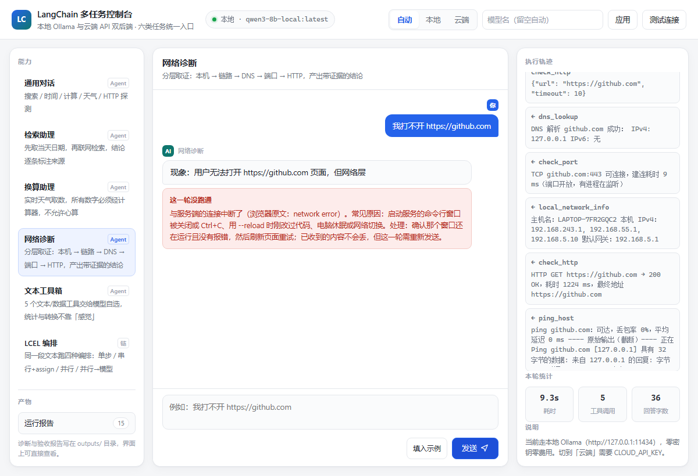

# 操作案例：照着做，六类能力逐个跑通

这份文档是**照着点就能复现**的操作手册。里面每个「你会看到什么」都来自本机实跑记录
（2026-10-29 19:45 那轮，模型 `qwen3-8b-local:latest`），不是估算值。

模型有随机性，**耗时差几秒、措辞不同都正常**；但「调了几个工具、产出了什么」是硬指标，可以对上。

---

## 第 0 步：把服务跑起来

### 界面路线（推荐先走这条）

打开一个命令行窗口，进项目目录，执行：

```bash
cd "C:\Users\huangan\Desktop\项目开发夹\lc-multitask-suite"
C:\Users\huangan\venvs\lc-multitask-suite\Scripts\python.exe serve.py --port 8011
```

看到这三行就算成功：

```
INFO:     Started server process
INFO:     Uvicorn running on http://127.0.0.1:8011
INFO:     Application startup complete.
```

然后浏览器打开 **http://127.0.0.1:8011**

> ### ⚠️ 这一步最容易踩的坑：那个命令行窗口不能关
>
> 服务就跑在那个窗口里。**关掉窗口、按 Ctrl+C、或电脑休眠**，界面上正在跑的那一轮会立刻断掉，
> 显示「这一轮没跑通」。
>
> 这是本项目实测中唯一一次「看起来像 bug 其实不是」的失败：服务被中断时，
> 浏览器给的错误原文是 `network error`（流读到一半被掐）和 `Failed to fetch`（服务已停止）。
> 现在的版本会把这两句翻译成「与服务端的连接中断了……确认那个窗口还在运行，然后刷新页面重试」。
>
> **判断方法**：如果界面突然全盘报错，先回头看那个窗口还在不在、有没有 Traceback。

这是服务被中断时的真实画面（我在「网络诊断」跑到第 9.3 秒时强制杀了服务）：



注意红框上方：**右侧 5 条工具轨迹的结果全都还在**（ping / DNS / 端口 / HTTP / 本机网络），
连「本轮统计 9.3s / 5 工具调用」都保留了。丢的只是「模型组织最后答案」那一步。
所以断流不等于白跑 —— 证据还在，刷新重发即可。

### 命令行路线

不需要界面时，直接用 CLI，做的是同一件事：

```bash
C:\Users\huangan\venvs\lc-multitask-suite\Scripts\python.exe main.py doctor
```

先跑 `doctor` 体检。全绿（每行前面是 `✓`）再往下走。若中文乱码，先执行 `set PYTHONIOENCODING=utf-8`。

---

## 界面结构（10 秒认清）

```
┌──────────────────────────────────────────────────────────┐
│ 顶栏：[自动|本地|云端]  模型输入框  　　　　● 本地 · qwen3-8b-local │
├────────┬────────────────────────────┬─────────────────────┤
│ 能力   │  对话区（打字机输出）        │ 执行轨迹            │
│ 通用对话│                            │ 本轮统计            │
│ 检索助理│                            │ 说明                │
│ 换算助理│                            │                     │
│ 网络诊断│                            │                     │
│ 文本工具│                            │                     │
│ LCEL编排│                            │                     │
│ 多段流水│                            │                     │
│ ────── │                            │                     │
│ 产物   │                            │                     │
│ 运行报告│                            │                     │
└────────┴────────────────────────────┴─────────────────────┘
```

- **左栏「能力」**：7 张卡，点一张就切换任务类型（切换不清空已有对话）
- **左栏「产物 → 运行报告」**：自动落盘的 Markdown 报告，点开能看全文
- **右下「执行轨迹」**：这一轮调了哪些工具、参数是什么、返回了什么 —— **这是本项目最值得看的地方**
- **输入区「填入示例」按钮**：一键填好该能力的内置样例

---

## 案例 1：检索助理 —— 看「先取日期，再检索，逐条标来源」

**目标**：理解 Agent 为什么必须**先调工具再回答**，以及为什么结论要标来源。

### 操作
1. 左栏点「检索助理」
2. 点「填入示例」，输入框出现：`今天是几月几号？历史上的今天有哪些重要事件？`
3. 点「发送」

### 你会看到什么

右侧轨迹依次出现（真实记录）：

```
① current_datetime ({})
   → 2026-10-29 19:41:30 星期四（2026 年第 302 天）
② web_search ({"query": "10月29日 历史上的今天 重大事件", "top_k": 5})
   → 1. 10月29日_百度百科 …
     2. 10月29日 历史上的今天 …
```

然后中间开始逐字输出，最终答案**每条事件都带一行「依据」**。

**实测**：耗时 7.4s / 14.0s（两次），工具调用 **2 次**，回答约 300 字。底部统计显示 `2 工具调用`。

### 判断成功的硬指标
- 轨迹里**必须有 `current_datetime` 且排在 `web_search` 前面**（模型被约束成「涉及今天必须先取日期」）
- 答案里出现「依据：来自……」

### 为什么值得看
模型本身不知道「今天是几月几号」，它的知识有截止日期。这两次工具调用把它从
「编一个 plausible 的答案」变成「先取证再回答」。

### 常见偏差
- **搜索结果跑偏**（比如返回「Windows 10」）：项目里 `filter_relevant` 会按「必须命中日期」过滤，
  宁可让模型看到「没搜到」，也不给它噪声。这是**故意设计**的 —— 拿到噪声证据的模型会一本正经地乱推理。

---

## 案例 2：换算助理 —— 看「数字不许心算」

**目标**：验证「所有数字必须经计算器」这条硬约束。

### 操作
1. 点「换算助理」→「填入示例」
2. 输入：`北京现在气温是多少华氏度？这个华氏温度的 1/4 是多少？`
3. 发送

### 你会看到什么（真实记录，8.0 秒，3 次工具调用）

```
① get_weather      ({"city": "北京"})
   → 中国北京市北京 实时天气：晴，气温 12.4°C，体感 9.4°C，相对湿度 52%
② calculator       ({"expression": "12.4 * 9/5 + 32"})
   → 54.32
③ calculator       ({"expression": "54.32 / 4"})
   → 13.58
```

答案：**12.4°C → 54.32°F，其 1/4 = 13.58**

### 判断成功的硬指标
- 轨迹里**恰好 3 次**工具调用：`get_weather` + 两次 `calculator`
- 能看到 `12.4 * 9/5 + 32` 这个表达式本身 —— 说明换算公式是模型写的、计算是工具做的

### 常见偏差
- **只调了 1 次 calculator**：模型直接心算了第二问。追问一句「1/4 那步为什么没用计算器」可以看它怎么圆。
- **天气数字不同**：正常，取的是实时天气。

---

## 案例 3：网络诊断 —— 看「并行取证」和「自动落盘」

**目标**：看 Agent 在**同一轮里并行调 5 个工具**，以及报告自动写盘。

### 操作
1. 点「网络诊断」→「填入示例」
2. 输入：`我打不开 https://github.com`
3. 发送

### 你会看到什么（真实记录，11.2 秒，5 次工具调用）

```
① local_network_info ({})                       → 主机名 LAPTOP-… 本机 IPv4 192.168.243.1 …
② ping_host     ({"target": "github.com", "count": 4})  → 可达，丢包 0%
③ dns_lookup    ({"hostname": "github.com"})     → IPv4: 127.0.0.1
④ check_port    ({"host": "github.com", "port": 443})   → 可连接，6 ms
⑤ check_http    ({"url": "https://github.com"})  → 200 OK，1261 ms
```

然后弹出提示：**已生成报告：network-diagnosis-20261029-195045.md**
左下「运行报告」徽标从 0 变成 1，点开能读全文。

答案结构固定是「现象 → 证据 → 结论」，本轮的结论是：**网络层和应用层都正常，问题不在链路**。

### 判断成功的硬指标
- 轨迹里 **5 条调用对 5 条返回**（早期版本这里有个 bug：5 条被合并成 1 条畸形参数）
- 左栏「运行报告」数字 +1，并能点开看到 Markdown 全文

### 一个真实观察点
这台机器上 `dns_lookup` 返回的是 `github.com → 127.0.0.1`。
正常公网解析不该是回环地址 —— 说明本机 DNS 被代理/拦截了。
**这正是这类诊断工具的价值**：它能告诉你「ping 通但解析被劫持」这种靠猜猜不出来的事。

---

## 案例 4：文本工具箱 —— 看「统计不靠感觉」

**目标**：5 个文本工具交给模型自选。

### 操作
1. 点「文本工具箱」→「填入示例」
2. 发送

### 你会看到什么（真实记录，2.2 秒，1 次工具调用）

```
① text_analysis ({"text": "这个产品非常好用…"})
   → 总字符数 58  中文字数 49  英文词数 0  行数 3  情感倾向：积极（正向词 5 / 负向词 0）
```

答案：**情感倾向积极，行数 3**

### 判断成功的硬指标
- 出现 `text_analysis` 调用
- 数字（58 / 49 / 3）是**工具算出来的**，不是模型估的 —— 让它手工数一段 58 字的文本，几乎必错

### 进阶：换成 CSV ↔ JSON
把输入改成：`把这段 JSON 转成 CSV：[{"name":"张三","city":"北京"},{"name":"李四","city":"上海"}]`
轨迹会换成 `data_conversion`，可以验证字段里带逗号、引号、换行时的转义是否正确。

---

## 案例 5：LCEL 编排 & 多段流水线 —— 看「链」和「Agent」的区别

**目标**：理解这两类任务**没有工具轨迹**，因为它们走的是固定编排，不是模型自选工具。

### 5a. LCEL 编排

操作：点「LCEL 编排」→ 输入框**留空**（用内置样本文案）→ 发送

你会看到（真实记录，**0.7 秒**，0 次工具调用，4 个 stage）：

```
阶段：单步 → 串行+assign → 并行 → 并行→模型
```

底部统计：工具调用 **0**。

### 5b. 多段流水线

操作：点「多段流水线」→ 输入 `LangChain 是什么？` → 发送

你会看到（真实记录，2.4 秒，3 个 stage）：

```
阶段1 中文→英文翻译
阶段2 英文要点
阶段3 回译中文
```

每段**单独计时**显示。

### 判断成功的硬指标
- 这两类任务的轨迹区**显示的是 stage（阶段），不是 tool_call**
- 底部「工具调用」恒为 0

### 为什么混在一起
对比着看最能说明问题：

| | Agent（案例 1-4） | 链（案例 5） |
|---|---|---|
| 谁决定调什么 | 模型判断 | 代码写死 |
| 轨迹显示 | tool_call / tool_result | stage |
| 耗时 | 2-14 秒 | 0.7-2.4 秒 |
| 适合 | 步骤不确定的问题 | 步骤固定的流水线 |

---

## 案例 6：切换模型后端（本地 ↔ 云端 ↔ 手输模型）

**目标**：三种方式切换模型，且**不用重启服务**。

### 6a. 点按钮切后端

操作：顶栏点「云端」，再点「本地」，观察顶栏右侧徽标

你会看到：徽标在 `云端 · qwen-turbo` 和 `本地 Ollama · qwen3-8b-local:latest` 之间切换。

**注意**：切换后**模型输入框会自动清空** —— 这是故意的，本地名 `qwen3:8b` 拿到云端就是 404。

### 6b. 手输任意模型名

操作：在顶栏模型输入框里**直接敲** `my-custom-model-v9` → 回车

你会看到：徽标变成 `云端 · my-custom-model-v9`

**候选列表只是提示，不是白名单。** 任意名字都能填：厂商每周上新、有些兼容端点压根不提供
`/v1/models`。写错了会怎样？照常发给厂商，返回 404 后翻译成「模型名不存在……」，不会甩堆栈。

### 6c. 命令行切

全局参数必须写在**子命令前面**：

```bash
python main.py --provider cloud --model qwen-turbo basic
python main.py --provider ollama doctor
```

### 6d. 配置文件切

`.env` 里改 `LLM_PROVIDER=cloud` + `CLOUD_API_KEY=sk-…`，**改完要重启服务**。

### 优先级
`--provider` 参数 / 界面选择 > `.env.local` > 系统环境变量 > `.env`

> ### ⚠️ 关于云端：一个必须知道的事实
>
> 本机环境变量里那个 DashScope 密钥**能通过认证**（`/models` 返回 184 个模型），
> 但**对话额度已经用尽**，实际调用返回 `429 limit_requests` / `403 AllocationQuota.FreeTierOnly`。
>
> 所以「云端接得通」是实测确认的，「云端能出答案」这台机器上演示不了 ——
> 去 [百炼控制台](https://bailian.console.aliyun.com) 充值或换个 key 就能用，**不用改任何代码**。
>
> 报错时界面显示的是「额度超限 + 三条处理路径」，不是 30 行 Python 堆栈。

---

## 案例 7：多轮对话记忆

**目标**：验证上下文记住了上一轮。

### 操作
1. 点「通用对话」
2. 第一轮：`北京今天天气怎么样？`（会调 `get_weather`）
3. 第二轮：**只输入** `那上海呢？`（不提天气两字）

### 判断成功的硬指标
- 第二轮模型**能理解你在问上海的天气**，并再调一次 `get_weather`
- 输入区出现「清空会话」按钮，可重置

### 命令行对照
```bash
python main.py memory
python main.py memory --trim 4        # 只保留最近 4 条历史进上下文
```

---

## 命令行完整对照表

界面上做的每一步，命令行都能复现：

| 界面操作 | CLI 等价命令 |
|---|---|
| 检索助理 | `python main.py research "今天是几月几号？历史上的今天有哪些重要事件？"` |
| 换算助理 | `python main.py analyst "北京现在气温是多少华氏度？"` |
| 网络诊断 | `python main.py netdiag "我打不开 https://github.com"` |
| 文本工具箱 | `python main.py toolkit` |
| LCEL 编排 | `python main.py pipeline` |
| 多段流水线 | `python main.py multistep "LangChain 是什么？"` |
| 通用对话 | `python main.py product -q "北京天气"` |
| 多轮记忆 | `python main.py memory` |
| 列工具 | `python main.py tools`（15 个） |
| 全量验收 | `python main.py verify` |

---

## 排错表

| 现象 | 原因 | 处理 |
|---|---|---|
| `这一轮没跑通 与服务端的连接中断了` | 启动服务的窗口被关 / Ctrl+C / 休眠 | 确认窗口还在，刷新页面重发 |
| `Failed to fetch` | 服务已完全停止 | 重新执行 `serve.py` |
| 卡在「运行中」很久不出字 | 模型在调工具（检索/诊断前几秒不吐字） | 等，看右侧轨迹有动静就是正常的 |
| 云端报 `额度或调用频率超限` | 免费额度用尽 | 充值 / 换 key / 点「本地」切回来 |
| 报 `模型名不存在` | 手输的名字该厂商没有 | `python main.py doctor` 看可用列表 |
| 报 `没有可用的模型后端` | Ollama 没跑且云端没配 key | `ollama serve` 或填 `CLOUD_API_KEY` |
| 中文乱码 / UnicodeEncodeError | Windows GBK 控制台 | 启动前 `set PYTHONIOENCODING=utf-8` |

**最省事的自救顺序**：

```bash
python main.py doctor     # 一次说清哪里不通
python -m pytest -q       # 109 个离线单测，1 秒级
python main.py verify     # 端到端全量
```

---

## 附：这一轮实跑的完整数据

| 能力 | 耗时 | 工具调用 | 输出 | 产物 |
|---|---|---|---|---|
| 检索助理 | 7.4s / 14.0s | 2 | ~300 字 | — |
| 换算助理 | 8.0s | 3 | 121 字 | — |
| 网络诊断 | 11.2s | 5 | 321 字 | ✅ 报告 md |
| 文本工具箱 | 2.2s | 1 | 17 字 | — |
| LCEL 编排 | 0.7s | 0（4 阶段） | 31 字 | — |
| 多段流水线 | 2.4s | 0（3 阶段） | 83 字 | — |

单元测试：`109 passed`；浏览器端到端：0 console 错误。
